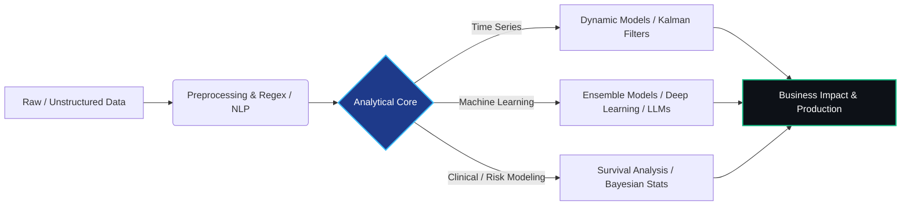

<div align="center">
  <!-- Dynamic Terminal Header -->
  

  <!-- Dynamic Typing SVG -->
  <a href="https://github.com/CarlosCandela02">
    
  </a>

  <br/>

  <!-- Minimalist Contact Badges -->
  <a href="https://www.linkedin.com/in/carlos-candela-giner-70126430a/" target="_blank">
    
  </a>
  <a href="mailto:candelaginercarlos@gmail.com">
    
  </a>
  
</div>

---

### `01.` // The Core Philosophy

I build Artificial Intelligence systems grounded in strict mathematical theory—understanding convergence, probabilistic modeling, and uncertainty propagation—to solve real-world business and engineering challenges. 

$$\hat{x}_{k\vert{}k} = \hat{x}_{k\vert{}k-1} + K_k (z_k - H_k \hat{x}_{k\vert{}k-1})$$
> *The Kalman Filter state update equation: A reminder that optimal decisions require dynamically updating our beliefs as new data arrives.*

```python
class DataScientist(Professional):
    def __init__(self):
        self.name = "Carlos Candela"
        self.education = {
            "Mathematics": "BSc, Universitat de València",
            "Biomedical_Eng": "BSc Degree",
            "Business_Mgmt": "MSc Degree",
            "AI_BigData_Cloud": "MSc, EDEM"
        }
        self.expertise = {
            "stochastic_processes": ["Dynamic Linear Models", "Kalman Filtering", "Bayesian Inference"],
            "machine_learning": ["LLM Prompt Engineering", "Random Forests", "Deep Learning"],
            "biostatistics": ["Survival Analysis", "Cox Proportional Hazards", "Kaplan-Meier"]
        }
        
    def deliver_value(self, raw_data: pd.DataFrame, business_goal: str) -> AI_System:
        """
        Translates complex mathematical foundations into actionable, scalable business solutions.
        """
        model = self._design_architecture(raw_data, rigor="strict")
        return model.deploy_to_production(target=business_goal)

```
02. // Professional Experience & Applied Research
🧠 AI & Data Engineer @ Matil
Engineered automated pipelines using Python, Advanced Regex, and LLM Prompt Engineering to extract and structure complex data from energy and gas invoices.
🌫️ Spatiotemporal Modeling & Time Series (BSc Mathematics TFG)
Analyzed and forecasted PM 
2.5
​	
  atmospheric pollution in Valencia using Dynamic Linear Models (DLMs), Kalman filtering, and Fourier seasonal components.
🧬 Clinical Survival Analysis (BSc Biomedical Engineering TFG)
Developed predictive mortality models for clinical cohorts combining Cox Proportional Hazards, Kaplan-Meier curves, and Random Forest algorithms.

03. // Technical Arsenal
Domain	Technologies & Frameworks
Languages & Core	
AI, ML & Stats	
Tools & Dev	

04. // Architecture & Work Paradigm
